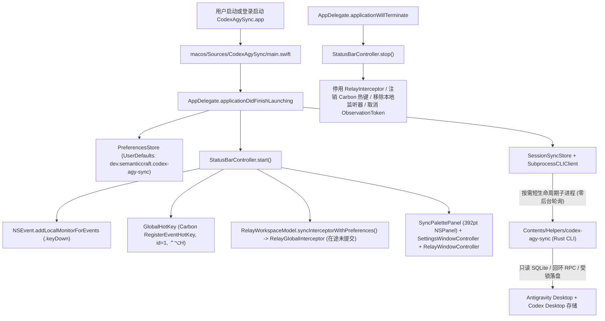
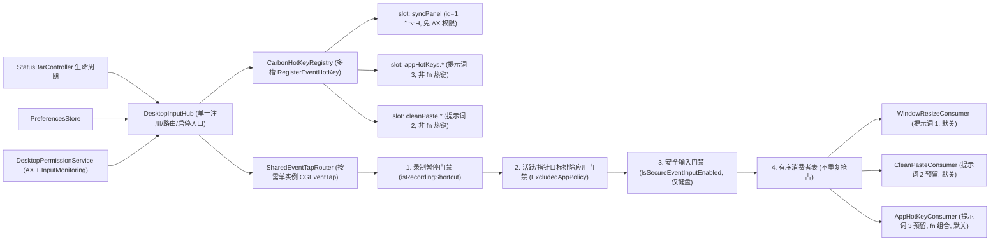

# INTEGRATION.md（codex-agy-sync 桌面三项能力共同架构前置调查）

日期：2026-11-24
阶段：第 0 节（只读架构调查，仓库零改动）
适用范围：窗口调整（提示词 1）、Clean Paste（提示词 2）、App Hotkeys（提示词 3）全部合入现有 `codex-agy-sync` 的原生 macOS 菜单栏应用 `CodexAgySync.app`。

---

## 1. 仓库定位与主机环境核实（事实）

以下信息均通过只读命令在当前工作机实测取得，未采用未核实候选假设。

| 项目 | 实测结果 |
| --- | --- |
| 主机名与系统 | `helios`，`macOS 27.2.1`（Build `26B131`），`arm64` |
| 仓库根路径 | `$HOME/Projects/codex-agy-sync`（候选路径 `/Volumes/Data/Projects/codex-agy-sync` 本机不存在） |
| 当前分支 | `main` |
| HEAD 提交 | `944c161246ce925a19fb3bf29c4e273a7a16b4e6`（`chore(lint): zero ordinary comments, extract 7 ADRs, and enforce comment-ratchet (#25)`） |
| 实际 Git Remote | `origin` 指向 `git@github.com:semantic-craft/codex-agy-sync.git`（fetch 与 push 相同） |
| 工作区状态 | **非干净**，存在 8 个已跟踪修改文件与 4 条未跟踪路径（共 25 个文件），全部属于在途 `Relay` 功能（详见 1.1 节） |
| 本机参考软件 | `/Applications/Kanary.app` 存在。本阶段未读取、未反编译、未修改且未注入该应用，严格遵守干净室约束 |

### 1.1 当前脏工作区明细（必须保留，不得覆盖）

通过 `git status --short` 与 `git diff --stat` 核实，当前在途改动集中于 `macos/`：

- 已修改跟踪文件（8 个）：`macos/Package.swift`、`macos/Sources/CodexAgySync/main.swift`、`macos/Sources/CodexAgySync/StatusBarController.swift`、`macos/Sources/CodexAgySync/SettingsWindowController.swift`、`macos/Sources/CodexAgySyncCore/PreferencesStore.swift`、`macos/Sources/CodexAgySyncCore/Localization.swift`、`macos/Sources/CodexAgySyncCore/PopoverFooterBar.swift`、`macos/Sources/CodexAgySyncCore/PopoverView.swift`。
- 未跟踪新增路径（4 条，含 17 个文件）：`macos/Sources/CodexAgySync/RelayWindowController.swift`、`macos/Sources/CodexAgySyncCore/Relay/`（14 个 Swift 文件，含 `RelayGlobalInterceptor.swift` 与 `RelayWorkspaceModel.swift`）、`macos/Tests/CodexAgySyncTests/RelayCoreTests.swift`、`macos/Tests/CodexAgySyncTests/RelayWorkspaceModelTests.swift`。

**架构影响**：在途的 `RelayGlobalInterceptor.swift` 已经引入了一个常驻的 `CGEventTap`（监听 `.keyDown` 的回车键以触发 `/relay`）以及 `AXIsProcessTrusted()` 检测与系统辅助功能深链。后续设计必须将它纳入统一的事件路由视野，避免新模块与其各自创建互不相通的事件监听器和权限引导。

---

## 2. 现有系统架构、模块划分与进程生命周期（事实）

### 2.1 技术栈与包清单（源码核实）

仓库包含三层协作代码，各自职责清晰：

1. **原生 macOS 菜单栏应用（`macos/Package.swift`）**：Swift 6.0，最低系统 `macOS 14.0`。
   - 库目标 `CodexAgySyncCore`：承载状态模型、偏好持久化、双语文案、CLI 子进程调用、更新服务、SwiftUI 面板与设置页（链接 `sqlite3` 与 `Carbon`）。
   - 可执行目标 `CodexAgySync`：承载 AppKit 宿主入口、状态栏面板、独立窗口控制器与全局热键（链接 `Carbon`）。
   - 测试目标 `CodexAgySyncTests`：依赖 `CodexAgySyncCore`，通过 `swift test` 运行。
   - 打包产物：`CodexAgySync.app`（`CFBundleIdentifier = dev.semanticcraft.codex-agy-sync`，`LSUIElement = true`，版本 `0.4.3`，由 `scripts/build_menubar_app.sh` 组装并签名）。
2. **内嵌 Rust CLI 核心（`rust/Cargo.toml`）**：Rust 2024 workspace（`cas-core`、`cas-codecs`、`cas-host`、`cas-cli`），版本 `0.4.3`。编译产出打入 `CodexAgySync.app/Contents/Helpers/codex-agy-sync`，负责按需会话扫描（`menubar-feed`）与双向同步（`sync` / `pair` / `status` / `inspect`）。
3. **Python 同步核心与工作台（`pyproject.toml`、`src/codex_agy_sync/`）**：6 层严格向下无环 DAG（Tier 0 `_wire.py`/`workspace.py`/`payloads.py` -> Tier 1 `events.py`/`ledger.py` -> Tier 2 `codecs/` -> Tier 3 `bridge/` -> Tier 4 `workbench/` -> Tier 5 `cli.py`），支撑独立控制台 `./bin/codex-agy-sync` 与冻结维护的 `serve` 透传。

### 2.2 进程结构与生命周期

- **常驻进程数**：仅 1 个用户会话级 GUI 进程（`CodexAgySync.app`，`LSUIElement = true`）。
- **无额外守护进程**：同步与会话列表完全采用按需短生命周期子进程（`C1` 原则），无 LaunchAgent 轮询。
- **进程策略结论**：三项新功能（窗口调整、Clean Paste、App Hotkeys）全部作为 `CodexAgySync.app` 进程内的原生 Swift/AppKit 模块实现，不新增后台进程、不新增 LaunchAgent、不触碰 Python/Rust 同步引擎。

### 2.3 现有全局热键、事件监听、权限与设置实态

| 维度 | 现有源码实现与符号 | 当前能力边界 |
| --- | --- | --- |
| 全局键盘热键 | `macos/Sources/CodexAgySync/GlobalHotKey.swift`（`GlobalHotKey`、`HotKeyCallbackBox`、`globalHotKeyEventCallback`） | 单槽 Carbon `InstallEventHandler` + `RegisterEventHotKey`（signature `0x4341_484B`，id `1`），默认 `⌃⌥H`。仅支持 `cmd/shift/option/control`，不支持 `fn`，不能处理鼠标拖动。不依赖辅助功能权限。 |
| 全局事件监听 | `macos/Sources/CodexAgySyncCore/Relay/RelayGlobalInterceptor.swift`（未提交，`RelayGlobalInterceptor.start`/`handleEvent`） | 创建 `.cgSessionEventTap`（`.headInsertEventTap`，`.defaultTap`），仅监听 `keyDown`，仅在支持 AI 应用前台按下无 Shift 回车时检查 `/relay`。检查 `AXIsProcessTrusted()` 与 `IsSecureEventInputEnabled()`，处理 `tapDisabledByTimeout`。 |
| 应用内本地按键 | `StatusBarController.installKeyMonitorIfNeeded`（`StatusBarController.swift:398`）与 `ShortcutRecorderSection.startShortcutRecording`（`ShortcutRecorderButton.swift:228`） | `NSEvent.addLocalMonitorForEvents(matching: .keyDown)`，分别服务面板导航（`↑/↓/↵/Esc/⌘R/⌘,/⌘L/⌘Q`）与设置页热键录制。 |
| 权限检测与引导 | `RelayWorkspaceModel.swift:101,672,762`（未提交）；已提交主干中**尚无**独立权限服务 | 仅在 `RelayWorkspaceModel` 内直接调 `AXIsProcessTrusted()` 及打开 `Privacy_Accessibility` URL。尚无统一的 `AXIsProcessTrustedWithOptions` 提示封装，也无 `CGPreflightListenEventAccess()` / Input Monitoring 检测与统一设置页状态卡片。 |
| 设置持久化 | `macos/Sources/CodexAgySyncCore/PreferencesStore.swift`（`AppPreferences`、`PreferencesStore`） | 单个 `Codable` 结构 JSON 编码写入 `UserDefaults` 键 `appPreferences`。含 `isProductionAppBundleProcess` 防护与 `MENUBAR_PREFS_SUITE` 沙盒路径覆盖，避免测试污染 `~/Library/Preferences/`。 |
| 设置界面与导航 | `SettingsWindowController.swift`、`SettingsView.swift`（`SettingsTab`: `.general` / `.updates`，宽 `520pt`）、`GeneralSettingsPane.swift`、`SettingsComponents.swift` | 打开时切换 `.regular` 激活策略，关闭时经 `StatusBarController.syncActivationPolicyAfterWindowClose()` 切回 `.accessory`。双语文案集中于 `Localization.swift`（`AppCopy` / `AppCopyKey`，支持免重启实时切换 `zh-Hans`/`en`）。 |
| 登录启动 | `PreferencesStore.swift:315`（`SMAppServiceLoginItemManager`） | 已有 `SMAppService.mainApp` 开关与 `MENUBAR_DISABLE_LOGIN_ITEM=1` 测试开关。 |
| 构建与测试门禁 | `./scripts/check`（6 步）、`./scripts/build_menubar_app.sh`、`skills/verify-codex-agy-sync/scripts/menubar_verify.py` | 强制校验：`swift test`、`cfprefsd` 7.5 秒零 plist 泄漏、`lsregister` 零幽灵包、`scripts/check_architecture.py` Python DAG、`.comment-ratchet.json` 零普通注释（`max_total = 0`）、Swift 字面量禁用词扫描、反向 DNS 测试 `suiteName` 禁用扫描。 |

---

## 3. 现有 Codex / Antigravity 同步功能的不可破坏面

以下行为在引入共享输入接缝和三项桌面能力时必须保持零退化：

1. **同步核心零侵入**：`src/codex_agy_sync/`、`rust/`、`schema/` 与 `bin/codex-agy-sync` 的任何同步协议、WAL 锁守卫、只读查询与 `csrfToken` 隔离逻辑不作修改。
2. **默认全局快捷键与面板交互不变**：
   - `⌃⌥H`（`HotKeyShortcut.defaultShortcut`）在默认安装后行为与权限需求不变（即便未授辅助功能权限也必须继续工作）。
   - `StatusBarController.handleKeyDown` 内的 `↑/↓/↵/Esc/⌘R/⌘,/⌘L/⌘Q` 与 `ShortcutRecorderSection` 录制时暂停全局热键的行为不被破坏。
   - 更新重启前 `updateViewModel.onPrepareForRelaunch` 释放全局资源、失败后 `onRelaunchFailed` 恢复的钩子继续覆盖所有新注册的绑定。
3. **测试环境变量守卫不变**：
   - `MENUBAR_DISABLE_GLOBAL_HOTKEY=1` 必须同时禁止 Carbon 热键与共享 `CGEventTap` 启动，确保自动化测试与 QA 沙盒不劫持宿主机输入。
   - `MENUBAR_PREFS_SUITE` 与 `isProductionAppBundleProcess` 继续保证 `swift test` 零触碰 `~/Library/Preferences/`。
4. **启动零打扰**：三项新功能默认关闭（`isEnabled = false`），首次启动或升级后不弹出辅助功能或输入监控授权框，不创建空闲 `CGEventTap`。
5. **在途 `Relay` 改动安全共存**：不覆盖或破坏当前工作区中未提交的 `Relay/` 文件与测试。

---

## 4. 统一注册、路由与生命周期入口设计（`DesktopInputHub`）

### 4.1 为什么现有代码无法直接承接三项功能

- 现有 `GlobalHotKey.swift` 硬编码单槽 `identifier = 1`，只承载 Carbon `RegisterEventHotKey`，无法支持多快捷键槽位，也无法捕获 `fn` 修饰键（Carbon API 不支持 `fn`）或鼠标拖动事件。
- 在途 `RelayGlobalInterceptor.swift` 是专为 `/relay` 写的单用途 `CGEventTap`，事件掩码写死为 `.keyDown`，没有多消费者仲裁、通用排除应用列表或快捷键录制暂停协作。
- 若三项各自创建独立监听器和权限逻辑，会导致同一按键/鼠标事件被多次截取、录制快捷键时漏停某一监听器、权限状态显示彼此矛盾，以及退出或重拉起时资源泄漏。

### 4.2 共享机制架构（统一入口协调共存底层）

在 `CodexAgySyncCore` 内新建 `DesktopInput/` 模块，提供单一协调入口 `DesktopInputHub`，由 `StatusBarController` 在 `start()` / 偏好变化 / `onPrepareForRelaunch` / `stop()` 中统一驱动：

#### 关键设计选择与理由

1. **双底层共存、单入口协调**：
   - `CarbonHotKeyRegistry` 承接不涉及 `fn` 且不需要鼠标事件的常规全局热键（现有 Sync 面板 `⌃⌥H` 始终占 `id = 1`，无需辅助功能权限即可工作；后续提示词 2/3 的常规热键也复用同一 Carbon 事件处理器，按 `EventHotKeyID.id` 分发）。
   - `SharedEventTapRouter` 承接必须使用 `CGEventTap` 的事件流（`fn` 修饰键组合、鼠标移动/拖动拦截、按键吞吐改写）。其 `CGEventMask` 为当前**已启用且已获授权**消费者所需事件类型的并集；当并集为空时，彻底注销 `CFMachPort`，零常驻开销。
2. **明确的事件消费契约（禁止重复处理）**：
   - 每个 `EventTapConsumer` 实现纯决策接口 `handle(_ event: RoutedInputEvent, context: InputEventContext) -> InputRoutingDecision`（`.passThrough` / `.consume`）。
   - 路由器按固定优先级顺序遍历消费者，一旦某个消费者返回 `.consume`，立即停止向后续消费者派发并返回 `nil` 吞掉事件；任何未命中、权限缺失、录制中、安全输入或命中排除名单的事件一律返回原事件透传。
   - 收到 `.tapDisabledByTimeout` / `.tapDisabledByUserInput` 时，统一重启用 tap 并广播 `onTapReset()` 给所有活跃消费者，确保进行中的拖动或分屏手势立即取消复位，避免状态卡死。
3. **与在途 `RelayGlobalInterceptor` 的关系**：
   - 本轮窗口调整不改动未提交的 `RelayGlobalInterceptor.swift` 以防越界干扰在途任务；两者事件集无交集（`Relay` 只拦截无修饰键的 `Return`，窗口调整只拦截含 `fn+ctrl` 的修饰组合或活动手势期间的鼠标/`Esc`）。
   - `SharedEventTapRouter` 预留了 `.relaySlashCommand` 消费者槽位，待 `Relay` 分支稳定合入主干后可无缝收敛进同一 tap。
4. **纯逻辑与系统边界分离（可测试性）**：
   - 路由仲裁、排除名单匹配、冲突检测、窗口几何计算与状态机全部写成纯 Swift 值类型与协议，置于 `CodexAgySyncCore`，在 `swift test` 中无需系统权限或真实桌面窗口即可 100% 单元测试。
   - `AXUIElement`、`CGEvent.tapCreate`、`CopySymbolicHotKeys` 与 Carbon 调用全部封装在薄协议适配器中，仅在边界做错误归一化。

---

## 5. 权限、设置、排除名单与 UI 接缝

### 5.1 权限接缝（`DesktopPermissionService`）

- 集中管理两类 macOS TCC 权限：
  - **辅助功能（Accessibility）**：只读检查 `AXIsProcessTrusted()`，用户点击授权按钮时调用 `AXIsProcessTrustedWithOptions([kAXTrustedCheckOptionPrompt: true])`，提供跳转 `x-apple.systempreferences:com.apple.preference.security?Privacy_Accessibility`。
  - **输入监控（Input Monitoring）**：只读检查 `CGPreflightListenEventAccess()`，用户点击授权按钮时调用 `CGRequestListenEventAccess()`，提供跳转 `x-apple.systempreferences:com.apple.preference.security?Privacy_ListenEvent`。
- **静默降级契约**：
  - 仅在用户开启依赖权限的功能模块时展示权限状态条；不主动在 App 启动时弹系统权限窗。
  - 若开启模块时权限未授予，或运行期间用户在系统设置中撤销权限导致 `CGEvent.tapCreate` 返回 `nil` 或 `AXUIElement` 返回 `.apiDisabled`，对应模块自动进入 `.pausedMissingPermission` 状态，注销事件监听、透传所有按键与鼠标事件，不阻断 `CodexAgySync` 同步功能。
  - 当设置窗口变为 Key Window 或用户点击“重新检测”时刷新权限状态并自动重同步 `DesktopInputHub`。

### 5.2 设置存储接缝（`AppPreferences` 向后兼容扩展）

在 `macos/Sources/CodexAgySyncCore/PreferencesStore.swift` 的 `AppPreferences` 中按模块新增可选解码字段，旧版 plist 缺失键时一律解码为默认关闭：

- `windowResize: WindowResizePreferences`（默认 `isEnabled = false`，`nearestCornerResize = false`，`excludedBundleIds = []`）。
- 提示词 2 与 提示词 3 阶段再按同等模式分别加入 `cleanPaste` 与 `appHotKeys`（本阶段及提示词 1 不提前写入另外两项的业务逻辑）。
- 所有新增偏好读写继续经 `PreferencesStore.update` 与单一 `appPreferences` JSON 键，严格保留 `isProductionAppBundleProcess` 与沙盒 `MENUBAR_PREFS_SUITE` 隔离。

### 5.3 排除应用接缝（`ExcludedAppList`）

- 标识方式：采用应用 `Bundle Identifier`（如 `com.apple.Terminal`）为主键，辅以按需解析显示名与图标（通过 `NSWorkspace.shared.urlForApplication(withBundleIdentifier:)`），支持从运行中应用列表选取或通过 `NSOpenPanel` 选取 `.app` 包。
- 复用方式：在 `CodexAgySyncCore` 提供共享的 `ExcludedAppMatcher` 逻辑与 `ExcludedAppsCard` SwiftUI 组件；各功能模块各自持有独立的 `excludedBundleIds: [String]`（避免窗口调整排除某应用时误伤 Clean Paste），但共享同一套匹配、去重、归一化与编辑 UI。

### 5.4 设置 UI 信息架构扩展

现有 `SettingsView.swift` 顶部为等宽分栏（`SettingsTab`：`常规` / `版本与更新`，窗宽 `520pt`）。为容纳三项桌面能力同时保持现有同步设置清爽：

- 将 `SettingsTab` 扩展为 3 栏：`.general`（常规 / 现有同步配置）、`.desktopTools`（桌面工具 / Desktop Tools）、`.updates`（版本与更新）。
- 在 `.desktopTools` 标签页内使用 `ScrollView` + 现有 `SettingsCard` 风格，顶部展示共享权限状态卡片（仅在有模块开启且缺权时高亮警告），下方按模块折叠或分区展示：
  1. 窗口调整卡片（提示词 1 落地）
  2. Clean Paste 卡片（提示词 2 落地）
  3. App Hotkeys 卡片（提示词 3 落地）
- 所有新文案统一录入 `Localization.swift` 的 `AppCopyKey`（同时提供 `zh-Hans` 与 `en`，遵守零禁用词与无障碍标签规范）。

---

## 6. 三模块默认关闭与逐项交付路线

三项能力全部严格默认关闭（`isEnabled = false`），未经用户显式开启不得激活事件监听或改动系统按键行为。按以下单向顺序逐项落地并验收：

| 顺序 | 阶段 | 范围与计划改动文件草稿 | 验收关卡 |
| --- | --- | --- | --- |
| 前置 | 共享接缝落地（随提示词 1 第一批提交） | 新增 `DesktopInput/`（`DesktopInputHub.swift`、`CarbonHotKeyRegistry.swift`、`SharedEventTapRouter.swift`、`DesktopPermissionService.swift`、`ShortcutConflictDetector.swift`、`ExcludedAppMatcher.swift`）；改造 `GlobalHotKey.swift`（或迁入 `CarbonHotKeyRegistry`）与 `StatusBarController.swift` 接入统一生命周期 | 现有 `⌃⌥H` 行为不变、三项关闭时零 `CGEventTap`、`./scripts/check` 全绿 |
| 1 | 提示词 1：窗口调整 | 新增 `WindowResize/`（`WindowResizePreferences.swift`、`WindowGeometry.swift`、`WindowResizeStateMachine.swift`、`AXWindowDriver.swift`、`NativeTilingBridge.swift`、`WindowResizeConsumer.swift`、`WindowResizeSettingsCard.swift`、`GestureHUDController.swift`）；接线 `PreferencesStore.swift`、`SettingsView.swift`、`Localization.swift`、`StatusBarController.swift`；新增单元测试 `WindowResizeTests.swift` 与 `DesktopInputHubTests.swift` | 核对 6 条截图事实 + 排除透传 + 缺权透传 + 差异清单 + 同步回归全绿 |
| 2 | 提示词 2：Clean Paste | 在 `DesktopInputHub` 挂载 `CleanPasteConsumer` / Carbon 槽位，扩展 `AppPreferences`、`DesktopToolsSettingsPane` 与单元测试（提示词 1 未验收前不开始） | Clean Paste 独立 SPEC 与验收 |
| 3 | 提示词 3：App Hotkeys | 在 `DesktopInputHub` 挂载 `AppHotKeyConsumer` / Carbon 槽位，复用 `AppActivator` 与排除名单，扩展 `AppPreferences`、`DesktopToolsSettingsPane` 与单元测试（提示词 2 未验收前不开始） | App Hotkeys 独立 SPEC 与验收 |

---

## 7. 快捷键冲突可检测范围与用户提示策略

### 7.1 可检测范围（程序可确定性判定）

1. **本应用内部冲突**：Sync 面板快捷键、窗口调整固定修饰组合（`fn + ctrl` 系列）、未来 Clean Paste 与 App Hotkeys 之间的键位重叠。
2. **Carbon 热键独占冲突**：`RegisterEventHotKey` 返回非 `noErr`（如 `eventHotKeyExistsErr = -9878`）。
3. **系统符号快捷键冲突**：通过 Carbon `CopySymbolicHotKeys(_:)` 枚举已启用的系统快捷键（如 Spotlight、截屏、输入法切换、调度中心等）并与已配置组合比对。
4. **macOS 15+ 原生窗口平铺重叠**：在 macOS 15 及以上系统，系统自带 `Window -> Move & Resize` 快捷键正是 `Globe(Fn) + Ctrl + 方向键 / F / C / R`，与提示词 1 的键盘摆放键位一致（详见 `WINDOW_RESIZE_SPEC.md` 第 4 节的协作与接管策略）。

### 7.2 不可检测范围（macOS 公开 API 固有限制）

1. 其他第三方应用的 `CGEventTap` 监听（如 Rectangle、Magnet、BetterSnapTool、Raycast、AltTab、Kanary 等），macOS 不提供枚举其他进程 event tap 的公开 API。
2. 底层 HID/驱动级重映射工具（如 Karabiner-Elements）。
3. 前台应用内部自行处理的菜单或局部按键事件（仅在其被激活时体现）。
4. 第三方外接键盘未向 macOS 发送 `kCGEventFlagMaskSecondaryFn` 的硬件层 `Fn` 键。

### 7.3 冲突发生时的用户提示

- 可检测冲突：在设置页对应模块内联显示红色/橙色冲突提示，标明冲突来源（如“与同步面板快捷键冲突”或“与系统快捷键冲突”），不静默吞错。
- 不可检测冲突与无法独占：在事件 tap 创建失败或运行中持续无响应风险说明处，展示简明提示卡，告知“无法自动检测第三方窗口/快捷键工具（如 Rectangle、Magnet、Raycast）或外接键盘固件 `Fn` 键占用；若触发异常请检查冲突工具或系统键盘快捷键设置”，并保持安全降级与透传。

---

## 8. 同步功能回归清单（每次落地必跑）

1. 运行 `./scripts/check` 全部 6 步（含 `verify_session_mapping.py` 只读解码、Python 6-tier AST 检查、安全卫生与字面量扫描、`.comment-ratchet.json` 零普通注释门禁、`swift test` + 7.5 秒 `cfprefsd` 延迟落盘零污染与零 LaunchServices 残留、Rust `fmt/clippy/test` 与 8 组差分验证）。
2. 验证未启用任何桌面新模块时：启动 `CodexAgySync.app` 不请求辅助功能/输入监控权限，`SharedEventTapRouter` 不创建 `CGEventTap`。
3. 验证默认 `⌃⌥H` 在未授辅助功能权限时仍能正常呼出/执行同步面板；录制新快捷键时全局热键暂停，取消或关闭设置窗后恢复。
4. 验证 `menubar-feed` 与 `sync` 流程在启用/关闭桌面模块前后输出与行为完全一致；运行 `python3 skills/verify-codex-agy-sync/scripts/menubar_verify.py suite`。
5. 验证实机在途 `Relay` 单元测试（`RelayCoreTests`、`RelayWorkspaceModelTests`）继续通过，不覆盖或回滚未提交的 `Relay/` 文件。

---

## 9. 事实、推断与未知分列

### 事实（已从源码或本机直接核实）
- 仓库位置 `$HOME/Projects/codex-agy-sync`，分支 `main`，HEAD `944c161`，远程 `git@github.com:semantic-craft/codex-agy-sync.git`，主机 `helios`（`macOS 27.2.1` `arm64`）。
- 工作区存在 25 个在途未提交 `Relay` 文件，其中 `RelayGlobalInterceptor.swift` 已使用 `.cgSessionEventTap` 与 `AXIsProcessTrusted()`。
- 现有 `CodexAgySync.app` 为 Swift 6 / macOS 14+ 单常驻菜单栏应用（`LSUIElement = true`），通过短生命周期内嵌 Rust CLI 驱动同步；`GlobalHotKey.swift` 为单槽 Carbon 热键；`PreferencesStore.swift` 使用单键 JSON `UserDefaults` 且有沙盒隔离；`scripts/check` 强制 0 普通注释与 7.5 秒 `cfprefsd` 零泄漏检查。
- 经 Apple 官方文档与开源参考核实：Carbon `RegisterEventHotKey` 不支持 `fn` 修饰键；`fn` 需通过 `CGEventTap` 检查 `CGEventFlags.maskSecondaryFn`；macOS 15+ 原生 `Window -> Move & Resize` 快捷键即 `Globe(Fn) + Ctrl + 方向键 / F / C / R`。

### 推断（基于上述事实的架构判断）
- 将共享 `DesktopInputHub` 放入 `CodexAgySyncCore` 并由 `StatusBarController` 持有，是在不新增进程、不侵入 Python/Rust 核心、且保持 100% XCTest 可测性前提下耦合度最低的接缝方案。
- 将 `SettingsTab` 扩为 3 栏（`常规` / `桌面工具` / `版本与更新`）可在不撑宽 `520pt` 窗口的前提下容纳三项后续模块与统一权限状态。

### 未知 / 待验证
- **在途 `Relay` 改动如何处理**：是否直接保留在当前工作区并在其之上增量开发（不触碰 `Relay/`），还是等待用户先提交/清理 `Relay` 改动，或新建独立 git worktree / 分支进行桌面三项开发。
- **`INTEGRATION.md` 与各功能 SPEC 是否需随代码提交入仓**（例如放入 `docs/desktop-tools/`），还是仅作为会话审阅文档保留。
- 提示词 1 中关于“拖动”是否要求按下鼠标左键（详见 `WINDOW_RESIZE_SPEC.md` 待验证项）。

---

## 10. 在线检索计划与已完成来源

### 已完成检索（服务第 0 节与提示词 1）
1. **Apple Accessibility API 文档**：`AXIsProcessTrustedWithOptions`、`kAXTrustedCheckOptionPrompt`、`AXUIElementCopyElementAtPosition`、`kAXPositionAttribute`、`kAXSizeAttribute`、`AXFullScreenButton` / `AXZoomButton`、`kAXFullScreenAttribute`。
2. **Apple CoreGraphics / Carbon 事件与权限文档**：`CGEvent.tapCreate`、`CGEventFlags.maskSecondaryFn`、`CGPreflightListenEventAccess`、`CopySymbolicHotKeys`、Carbon `RegisterEventHotKey` 修饰键范围限制。
3. **Apple macOS Sequoia 原生窗口平铺文档**：`Window -> Move & Resize` 菜单层级及默认快捷键 `Globe(Fn) + Ctrl + 方向键 / F / C / R`、Tiling 与 Split View 的区别。
4. **开源窗口管理工具公开实践**：`SwiftShift`（`pablopunk/SwiftShift`，指针下窗口 + 四象限/最近角缩放）、`Snatch`（`TypoStudio/snatch`，`CGEventTap` + `AXEnhancedUserInterface` 临时关闭修复 Electron/Chromium 拖动卡顿）、`MouseDef`（`zenangst/MouseDef`，修饰键拖动）、`Rectangle`（AX 窗口几何与 Sequoia 平铺兼容讨论）。

### 后续阶段待检索计划（提示词 2 与 提示词 3 开始前执行）
- **提示词 2（Clean Paste）**：Apple `NSPasteboard` 多类型表示（`public.utf8-plain-text`、`public.rtf`、`public.html`、transient/concealed 标记 `org.nspasteboard.TransientType`）、`CGEvent` 合成 `⌘V` 时序与剪贴板还原；开源参考如 `Pure Paste`（`sindresorhus/Pure-Paste`）与 `Maccy`。
- **提示词 3（App Hotkeys）**：Apple `NSWorkspace` / `NSRunningApplication` 激活/隐藏/恢复语义、`LSApplication` 多实例与多 Space 切换、`KeyboardShortcuts`（`sindresorhus/KeyboardShortcuts`）快捷键录制与冲突提示模式。
